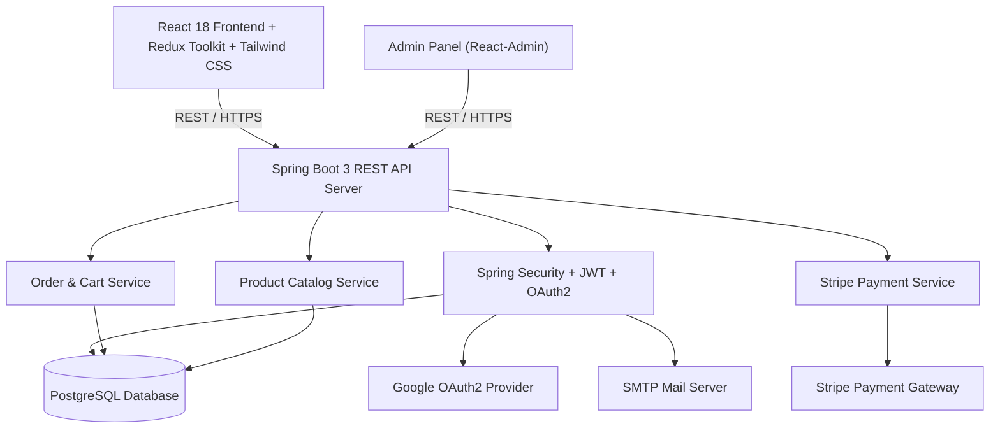

# 🛒 ShopEase — Enterprise Fullstack E-Commerce Platform

[](https://github.com/gauravkal006)
[](https://spring.io/projects/spring-boot)
[](https://react.dev/)
[](https://redux-toolkit.js.org/)
[](https://www.postgresql.org/)
[](https://stripe.com/)
[](https://tailwindcss.com/)

ShopEase is a full-featured, scalable, and responsive full-stack e-commerce solution engineered with a modern **React 18** client and a robust **Spring Boot 3** RESTful backend. It delivers a secure, end-to-end shopping experience—from product discovery and multi-parameter filtering to real-time cart state management, automated email verification, OAuth2 Google login, Stripe payment processing, and a dedicated React Admin dashboard.

---

## 🌟 Key Novelty & Technical Highlights

- **Decoupled Modern Architecture**: Clean separation between a responsive React single-page frontend and a modular, stateless Spring Boot micro-backend.
- **Dual Authentication & Security Suite**:
  - Stateless **JWT (JSON Web Token)** authentication with role-based access control (`ROLE_USER`, `ROLE_ADMIN`).
  - Integrated **OAuth2 Google Social Login** for seamless one-click authentication.
  - Verification code workflow via Spring Mail for secure account registration.
- **Dynamic Product Filtering Engine**:
  - Multi-faceted catalog search supporting dynamic category navigation, price-range sliders, and product tagging.
  - Spring Data JPA criteria queries for performant, indexed database retrieval.
- **End-to-End Cart & Order Management**:
  - Persistent, synchronized shopping cart powered by Redux Toolkit.
  - Real-time stock availability checks and dynamic price calculation.
- **Seamless Stripe Payment Gateway**:
  - Server-side Stripe PaymentIntent creation with client-side Stripe Elements for PCI-compliant checkout.
- **Comprehensive Admin Control Panel**:
  - Back-office administration panel built using `react-admin` for streamlined inventory, category, and order lifecycle management.
- **Cloud & Media Ready**:
  - Support for external CDN/file storage zones for high-resolution product imagery.
  - Containerization and deployment-ready architecture with PostgreSQL datasource abstraction.

---

## 🏛️ System Architecture



---

## 🛠️ Tech Stack

### Frontend (`/UI`)
| Technology | Role |
| :--- | :--- |
| **React 18** | Declarative component-based UI |
| **Redux Toolkit** | Centralized client state management (cart, auth, filter state) |
| **React Router v6** | Declarative, nested client-side routing |
| **Tailwind CSS** | Responsive styling & modern design system |
| **Axios** | HTTP client with automatic JWT bearer interceptors |
| **Stripe React SDK** | Secure embedded card payment elements |
| **React Admin** | Dedicated administrative management console |

### Backend (`/backend`)
| Technology | Role |
| :--- | :--- |
| **Java 17** | Modern LTS runtime platform |
| **Spring Boot 3.3.2** | Core enterprise application framework |
| **Spring Security 6** | Role-based authorization & filter chains |
| **Spring Data JPA & Hibernate** | Object-relational mapping & database persistence |
| **jjwt (JSON Web Token)** | Cryptographic token creation and validation |
| **Stripe Java SDK** | Server-side payment intent generation |
| **Spring Mail** | Asynchronous email dispatch for verification |
| **PostgreSQL** | Relational data persistence |
| **Maven** | Build management & dependency resolution |

---

## 📁 Repository Structure

```
shopEase/
├── UI/                               # React frontend application
│   ├── public/                       # Static public assets
│   ├── src/
│   │   ├── api/                      # Axios client & endpoint handlers
│   │   ├── components/               # Reusable UI components (Navbar, Footer, etc.)
│   │   ├── pages/                    # Application pages (Home, Shop, Cart, Checkout, Admin)
│   │   ├── store/                    # Redux slices and store configuration
│   │   └── App.js                    # Route configurations & app shell
│   └── package.json                  # Frontend dependencies & scripts
│
├── backend/                          # Spring Boot REST API
│   ├── src/
│   │   ├── main/
│   │   │   ├── java/com/thecodereveal/shopease/
│   │   │   │   ├── auth/             # JWT, OAuth2, and user credentials modules
│   │   │   │   ├── controllers/      # REST API endpoints (Products, Orders, Payments)
│   │   │   │   ├── entities/         # JPA database models
│   │   │   │   ├── repositories/     # Spring Data JPA repositories
│   │   │   │   ├── services/         # Business logic layer
│   │   │   │   └── ShopeaseApplication.java # Spring Boot entry point
│   │   │   └── resources/
│   │   │       └── application.properties # Application configuration
│   └── pom.xml                       # Maven build configuration
│
├── shopEase.postman_collection.json  # Comprehensive Postman test collection
└── README.md                         # Documentation
```

---

## 🚀 Getting Started

### 1. Prerequisites
- **Node.js** (v18.x or later) & **npm**
- **Java Development Kit (JDK 17)**
- **Apache Maven 3.8+** (or use included `mvnw`)
- **PostgreSQL** database instance running locally or on cloud (e.g. Neon, Supabase, AWS RDS)

---

### 2. Backend Setup

1. **Navigate to the backend directory**:
   ```bash
   cd backend
   ```

2. **Configure Environment Variables**:
   Update `src/main/resources/application.properties` or provide environment variables:
   ```properties
   DB_HOST=localhost
   DB_USER=postgres
   DB_PASSWORD=your_password
   JWT_KEY=your_secure_256_bit_secret_key
   MAIL_PASSWORD=your_smtp_app_password
   GOOGLE_OAUTH2_CLIENT_ID=your_google_client_id
   GOOGLE_OAUTH2_CLIENT_SECRET=your_google_client_secret
   STRIPE_SECRET=sk_test_your_stripe_secret_key
   FILE_ZONE=your_file_zone
   CDN_KEY=your_cdn_key
   CDN_HOST=your_cdn_host
   ```

3. **Build and Run**:
   ```bash
   # Windows
   .\mvnw.cmd spring-boot:run

   # Linux / macOS
   ./mvnw spring-boot:run
   ```
   The backend service starts at: `http://localhost:8080`

---

### 3. Frontend Setup

1. **Navigate to the UI directory**:
   ```bash
   cd UI
   ```

2. **Install dependencies**:
   ```bash
   npm install
   ```

3. **Start development server**:
   ```bash
   npm start
   ```
   The client application opens automatically at: `http://localhost:3000`

---

## 🧪 API Verification & Testing

A complete Postman collection is included at the root: [`shopEase.postman_collection.json`](./shopEase.postman_collection.json).

### Steps to Test:
1. Open **Postman** and click **Import**.
2. Select `shopEase.postman_collection.json`.
3. Set the environment variable `endPoint` to `http://localhost:8080`.
4. Execute pre-configured flows:
   - **User Registration & Verification**
   - **JWT Authentication & Profile retrieval**
   - **Product Listings & Category Queries**
   - **Order Creation & Stripe Checkout Intent**

---

## 👤 Author & Maintainer

**Gaurav Kalamkhede**
- **GitHub**: [@gauravkal006](https://github.com/gauravkal006)
- **Email**: [kalamkhedejanardhan@gmail.com](mailto:kalamkhedejanardhan@gmail.com)
- **Role**: Fullstack Developer & Project Maintainer

---

## 📄 License

This project is open-source and available under the [MIT License](LICENSE).
